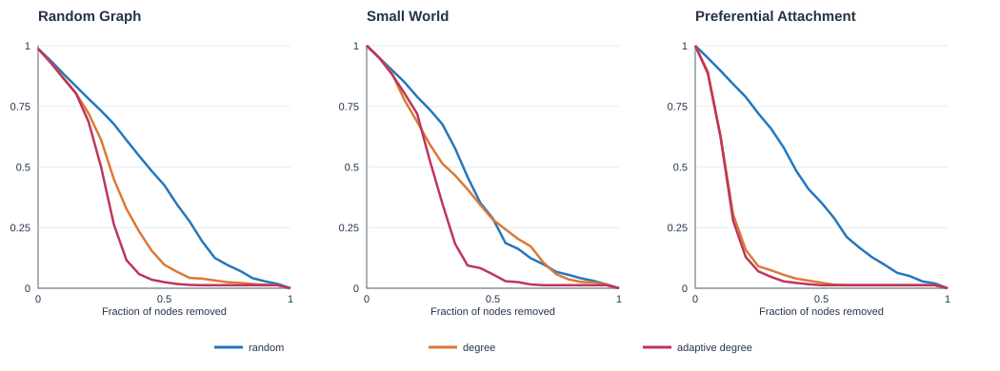

# When Do Networks Break? Exploring Network Resilience

An independent computational mathematics project studying how different types of networks respond when nodes fail randomly or important nodes are removed.

**This is a GitHub research repository, not a website.** All files are in this single folder.

## Research question

How does the structure of a network affect how quickly it breaks apart under random failures and targeted node removal?

## Results at a glance

The project simulates three synthetic network families (Erdős–Rényi, Watts–Strogatz, and Barabási–Albert) under three removal strategies: random, highest original degree, and highest remaining degree. The default experiment uses 12 replicates per combination: **3 × 3 × 12 = 108 runs**.



The plot shows the share of original nodes in the largest remaining connected component as nodes are removed. Higher curves indicate that more nodes remain connected. These are simulations, not real-world infrastructure measurements.

## Files

| File | Purpose |
| --- | --- |
| `analyze.py` | Generates graphs, runs removal experiments, and saves results |
| `test_analyze.py` | Automated checks |
| `experiment_summary.csv` | Per-run summary statistics |
| `resilience_curves.csv` | Detailed resilience curves |
| `resilience_chart.svg` | Figure generated from the experiments |
| `RESEARCH_REPORT.md` | Mathematical background, methods, findings, and limitations |
| `requirements.txt` | Dependency information (standard Python library only) |
| `LICENSE` | Project license |

## Run the experiments

Install **Python 3.10+**. No third-party packages are required.

```bash
python analyze.py
python -m unittest -v test_analyze.py
```

To change the experiment size or random seed:

```bash
python analyze.py --n 120 --replicates 30 --seed 20261121
```

Running the experiment writes updated CSV and SVG results in this same folder. The included results were generated with the default experiment settings.

## Approach

- Generate random networks with different structures.
- Remove nodes randomly, by their original degree, or by their current degree.
- Record the size of the largest connected component after each removal fraction.
- Compare resilience curves and their area under the curve (AUC).

## Research integrity

This is an **independent computational study of established network science methods**, not a peer-reviewed publication or a claim of a newly discovered theorem. The synthetic graph families differ in multiple properties, so the experiment alone cannot establish which single structural feature causes a difference. See `RESEARCH_REPORT.md` for limitations and possible extensions.
